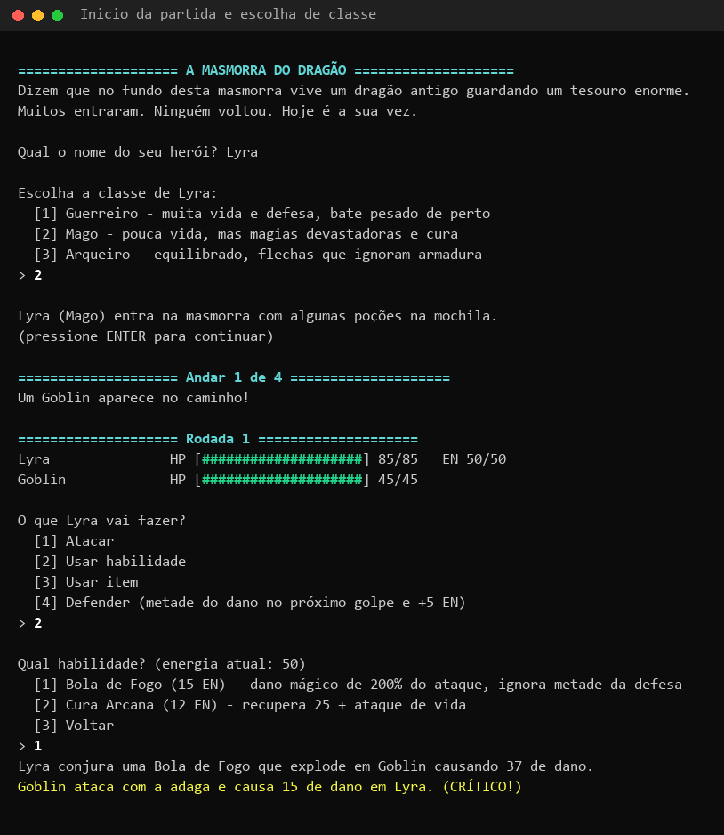
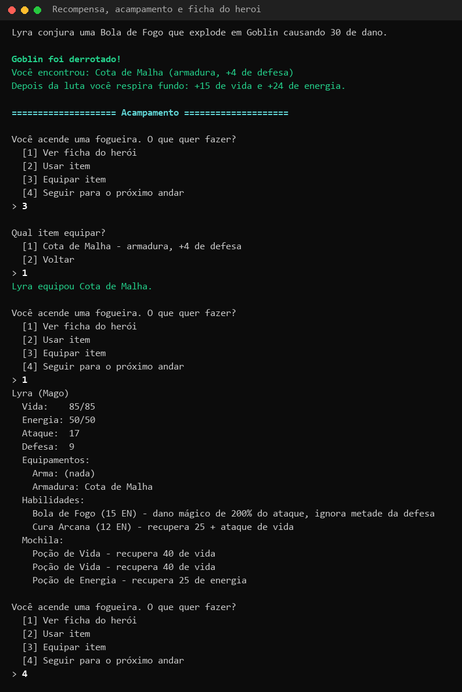
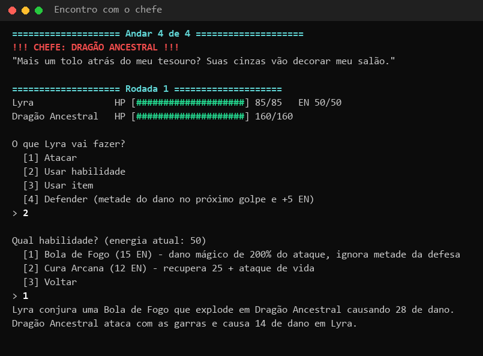
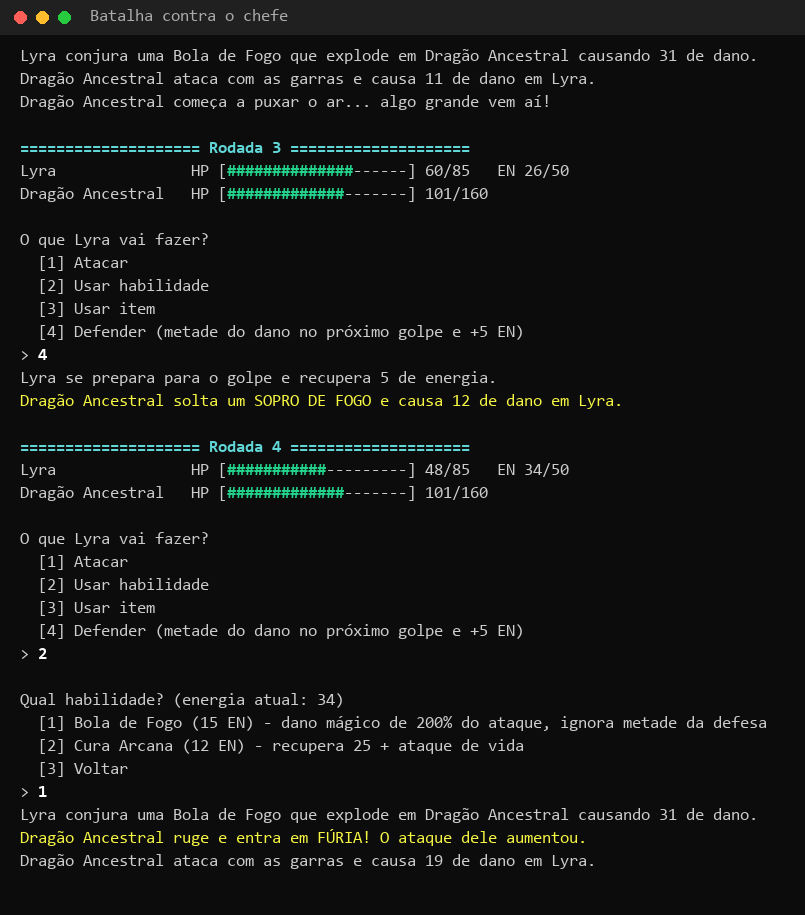
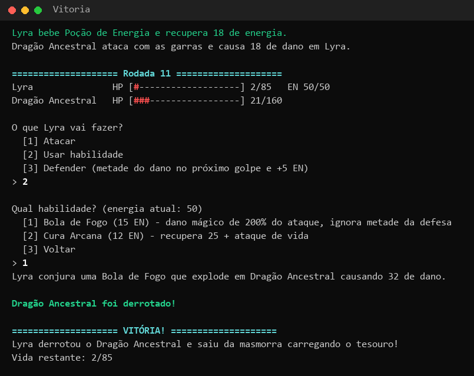

# A Masmorra do Dragão — RPG de Console em Java

Trabalho prático de **Paradigmas de Programação**: um RPG de turnos jogado no terminal, feito pra mostrar na prática os conceitos de **Programação Orientada a Objetos** e os **5 princípios SOLID**.

Você escolhe um herói (Guerreiro, Mago ou Arqueiro), desce 4 andares de uma masmorra enfrentando inimigos cada vez mais fortes, junta poções e equipamentos pelo caminho e, no último andar, encara o **Dragão Ancestral**.

> O código-fonte não tem nenhum comentário de propósito. Toda a explicação está aqui no README, nas seções [Explicando o código](#explicando-o-código-pacote-por-pacote) e [SOLID no projeto](#solid-no-projeto).

---

## Sumário

1. [Como compilar e rodar](#como-compilar-e-rodar)
2. [Como jogar](#como-jogar)
3. [Capturas de tela](#capturas-de-tela)
4. [Estrutura de pastas](#estrutura-de-pastas)
5. [Diagrama de classes (UML)](#diagrama-de-classes-uml)
6. [Explicando o código, pacote por pacote](#explicando-o-código-pacote-por-pacote)
7. [Conceitos de POO aplicados](#conceitos-de-poo-aplicados)
8. [SOLID no projeto](#solid-no-projeto)
9. [Como estender o jogo](#como-estender-o-jogo)

---

## Como compilar e rodar

### Pré-requisito

- **JDK 17 ou mais novo** (o projeto usa `record`, `switch` com seta e `Stream.toList()`).
  Pra conferir: `java -version` e `javac -version`.

Não tem nenhuma biblioteca externa, Maven ou Gradle. É só Java puro.

### Jeito rápido (scripts prontos)

**Windows** (Prompt de Comando ou PowerShell, na pasta do projeto):

```bat
executar.bat
```

**Linux / macOS / Git Bash:**

```sh
./executar.sh
```

Os dois scripts fazem a mesma coisa: apagam a pasta `out/`, compilam tudo de novo e iniciam o jogo. No Windows o script também roda `chcp 65001` pra os acentos aparecerem certinho no terminal.

### Jeito manual

```sh
javac --release 17 -encoding UTF-8 -d out -sourcepath src src/rpg/Main.java
java -cp out rpg.Main
```

- `-d out` joga os `.class` na pasta `out/` (que está no `.gitignore`).
- `-sourcepath src` faz o `javac` achar sozinho todas as classes que o `Main` usa.
- `-encoding UTF-8` garante que os textos com acento compilem direito em qualquer sistema.

### Semente fixa (opcional)

O jogo tem aleatoriedade (variação de dano, críticos, ações dos inimigos, recompensas). Se quiser repetir exatamente a mesma partida, passe uma semente:

```sh
java -cp out rpg.Main --semente 42
```

Isso também funciona pelos scripts: `executar.bat --semente 42`.

---

## Como jogar

Tudo é feito digitando o **número da opção** e apertando ENTER.

1. Digite o nome do herói e escolha a classe.
2. Cada andar tem um inimigo. A luta é em **rodadas**: você age, depois o inimigo age.
3. No seu turno você pode:
   - **Atacar** — ataque básico, não gasta nada.
   - **Usar habilidade** — golpes especiais que gastam **energia (EN)**.
   - **Usar item** — bebe uma poção da mochila (só aparece se você tiver alguma).
   - **Defender** — o próximo golpe que você levar causa metade do dano, e você ainda recupera 5 de energia.
4. Toda rodada você recupera 3 de energia automaticamente.
5. Venceu a luta? Você ganha um item aleatório, recupera 40% da vida e toda a energia, e vai pro **acampamento**, onde dá pra ver a ficha, usar poções e equipar armas/armaduras.
6. No andar 4 está o chefe. Fica de olho: quando ele **"começa a puxar o ar"**, o próximo turno dele é um Sopro de Fogo. Esse é o momento de defender.

### As classes

| Classe    | Vida | Ataque | Defesa | Energia | Habilidades |
|-----------|-----:|-------:|-------:|--------:|-------------|
| Guerreiro | 130  | 15     | 10     | 30      | Golpe Brutal (180% do ataque) e Investida com Escudo (120% + já fica defendendo) |
| Mago      | 85   | 17     | 5      | 50      | Bola de Fogo (200%, ignora metade da defesa) e Cura Arcana |
| Arqueiro  | 100  | 16     | 7      | 40      | Tiro Preciso (150%, ignora toda a defesa) e Disparo Duplo (duas flechas) |

### Os inimigos

| Andar | Inimigo | Vida | Comportamento |
|------:|---------|-----:|---------------|
| 1 | Goblin | 45 | às vezes dá um golpe sujo mais forte |
| 2 | Esqueleto | 60 | às vezes levanta o escudo e reduz o próximo dano |
| 3 | Orc | 85 | às vezes solta uma Pancada Esmagadora (160%) |
| 4 | **Dragão Ancestral** (chefe) | 160 | Sopro de Fogo a cada 3 turnos, avisa antes, e entra em fúria com metade da vida |

---

## Capturas de tela

Imagens geradas a partir de uma partida real (Mago, `--semente 5`).

**Início da partida, escolha de classe e primeira rodada**



**Recompensa, acampamento, equipando armadura e ficha do herói**



**Chegada ao chefe**



**Batalha contra o chefe: defendendo do Sopro de Fogo e o dragão entrando em fúria**



**Vitória com 2 de vida sobrando**



---

## Estrutura de pastas

```
.
├── executar.bat / executar.sh     scripts pra compilar e rodar
├── docs/imagens/                  capturas de tela usadas aqui no README
└── src/rpg/
    ├── Main.java                  ponto de entrada: monta e conecta todas as peças
    ├── combate/                   regras de batalha
    │   ├── Batalha.java
    │   ├── CalculadoraDeDano.java
    │   ├── CalculadoraDanoPadrao.java
    │   ├── ContextoBatalha.java
    │   ├── Dano.java
    │   ├── ResultadoBatalha.java
    │   └── acoes/                 o que o herói pode fazer no turno
    │       ├── AcaoDeCombate.java
    │       ├── AcaoAtacar.java
    │       ├── AcaoDefender.java
    │       ├── AcaoHabilidade.java
    │       └── AcaoUsarItem.java
    ├── habilidades/               golpes especiais dos heróis
    │   ├── Habilidade.java
    │   ├── GolpeBrutal.java, Investida.java       (Guerreiro)
    │   ├── BolaDeFogo.java, CuraArcana.java       (Mago)
    │   └── TiroPreciso.java, DisparoDuplo.java    (Arqueiro)
    ├── itens/                     itens, inventário e equipamentos
    │   ├── Item.java, ItemBase.java
    │   ├── Usavel.java, Equipavel.java, TipoEquipamento.java
    │   ├── PocaoDeVida.java, PocaoDeEnergia.java
    │   ├── Arma.java, Armadura.java
    │   ├── Inventario.java
    │   └── Equipamentos.java
    ├── jogo/                      fluxo da partida
    │   ├── Jogo.java
    │   ├── Masmorra.java
    │   ├── Acampamento.java
    │   ├── FabricaDeHerois.java
    │   └── GeradorDeRecompensas.java
    ├── personagens/
    │   ├── Combatente.java, Curavel.java, Personagem.java
    │   ├── herois/                Heroi, Guerreiro, Mago, Arqueiro
    │   └── inimigos/              Inimigo, Goblin, Esqueleto, Orc, Chefe, DragaoAncestral
    ├── ui/                        tudo que fala com o terminal
    │   ├── InterfaceJogo.java
    │   ├── ConsoleUI.java
    │   ├── FormatadorStatus.java
    │   └── EntradaEncerradaException.java
    └── util/                      aleatoriedade
        ├── Dado.java
        └── DadoAleatorio.java
```

A divisão em pacotes já segue uma ideia simples: **cada pacote cuida de um assunto**. Quem mexe com terminal fica em `ui`, quem mexe com regra de luta fica em `combate`, e por aí vai.

---

## Diagrama de classes (UML)

O diagrama abaixo é escrito em [Mermaid](https://mermaid.js.org/), que o GitHub desenha automaticamente. Legenda das setas:

- `<|--` herança (extends)
- `<|..` implementação de interface (implements)
- `*--` composição (a parte não existe sem o todo)
- `o--` agregação (guarda referência)
- `..>` dependência (usa)

```mermaid
classDiagram
    direction TB

    class Combatente {
        <<interface>>
        +getNome() String
        +getVida() int
        +getVidaMaxima() int
        +getAtaque() int
        +getDefesa() int
        +estaVivo() boolean
        +receberDano(int dano) int
    }
    class Curavel {
        <<interface>>
        +curar(int quantidade) int
    }
    class Personagem {
        <<abstract>>
        -String nome
        -int vidaMaxima
        -int ataqueBase
        -int defesaBase
        -int vida
        -boolean defendendo
        +receberDano(int dano) int
        +defender()
        +encerrarDefesa()
        #restaurarVida(int quantidade) int
    }
    class Heroi {
        <<abstract>>
        -int energia
        -int energiaMaxima
        -List~Habilidade~ habilidades
        -Inventario inventario
        -Equipamentos equipamentos
        +getClasse()* String
        +getAtaque() int
        +getDefesa() int
        +curar(int quantidade) int
        +gastarEnergia(int custo) boolean
        +recuperarEnergia(int quantidade) int
        +equipar(Equipavel item) Optional~Equipavel~
    }
    class Guerreiro
    class Mago
    class Arqueiro
    class Inimigo {
        <<abstract>>
        +getApresentacao() String
        +agir(Combatente alvo, CalculadoraDeDano calc, Dado dado)* String
        #golpear(Combatente alvo, int poder, CalculadoraDeDano calc, String acao) String
    }
    class Goblin
    class Esqueleto
    class Orc
    class Chefe {
        <<abstract>>
        #getFalaDeEntrada()* String
        +getApresentacao() String
    }
    class DragaoAncestral {
        -int turnos
        -boolean furioso
        +getAtaque() int
        +agir(...) String
    }

    Combatente <|.. Personagem
    Curavel <|.. Heroi
    Personagem <|-- Heroi
    Personagem <|-- Inimigo
    Heroi <|-- Guerreiro
    Heroi <|-- Mago
    Heroi <|-- Arqueiro
    Inimigo <|-- Goblin
    Inimigo <|-- Esqueleto
    Inimigo <|-- Orc
    Inimigo <|-- Chefe
    Chefe <|-- DragaoAncestral

    class Habilidade {
        <<interface>>
        +getNome() String
        +getDescricao() String
        +getCusto() int
        +executar(Heroi usuario, Combatente alvo, CalculadoraDeDano calc) String
    }
    class GolpeBrutal
    class Investida
    class BolaDeFogo
    class CuraArcana
    class TiroPreciso
    class DisparoDuplo
    Habilidade <|.. GolpeBrutal
    Habilidade <|.. Investida
    Habilidade <|.. BolaDeFogo
    Habilidade <|.. CuraArcana
    Habilidade <|.. TiroPreciso
    Habilidade <|.. DisparoDuplo
    Heroi o-- "2" Habilidade

    class Item {
        <<interface>>
        +getNome() String
        +getDescricao() String
    }
    class Usavel {
        <<interface>>
        +usar(Heroi heroi) String
    }
    class Equipavel {
        <<interface>>
        +getTipo() TipoEquipamento
        +getBonusAtaque() int
        +getBonusDefesa() int
    }
    class TipoEquipamento {
        <<enumeration>>
        ARMA
        ARMADURA
    }
    class ItemBase {
        <<abstract>>
        -String nome
        -String descricao
    }
    class PocaoDeVida {
        -int cura
    }
    class PocaoDeEnergia {
        -int energia
    }
    class Arma {
        -int bonusAtaque
    }
    class Armadura {
        -int bonusDefesa
    }
    class Inventario {
        -List~Item~ itens
        +adicionar(Item item)
        +remover(Item item) boolean
        +getUsaveis() List~Usavel~
        +getEquipaveis() List~Equipavel~
    }
    class Equipamentos {
        -EnumMap slots
        +equipar(Equipavel item) Optional~Equipavel~
        +getBonusAtaque() int
        +getBonusDefesa() int
    }
    Item <|-- Usavel
    Item <|-- Equipavel
    Item <|.. ItemBase
    ItemBase <|-- PocaoDeVida
    ItemBase <|-- PocaoDeEnergia
    ItemBase <|-- Arma
    ItemBase <|-- Armadura
    Usavel <|.. PocaoDeVida
    Usavel <|.. PocaoDeEnergia
    Equipavel <|.. Arma
    Equipavel <|.. Armadura
    Equipavel ..> TipoEquipamento
    Heroi *-- Inventario
    Heroi *-- Equipamentos
    Inventario o-- Item
    Equipamentos o-- Equipavel

    class CalculadoraDeDano {
        <<interface>>
        +calcular(int poder, int defesa) Dano
    }
    class CalculadoraDanoPadrao {
        -Dado dado
    }
    class Dano {
        <<record>>
        +int valor
        +boolean critico
        +marcador() String
    }
    class ContextoBatalha {
        <<record>>
        +Heroi heroi
        +Inimigo inimigo
        +InterfaceJogo ui
        +CalculadoraDeDano calculadora
    }
    class ResultadoBatalha {
        <<enumeration>>
        VITORIA
        DERROTA
    }
    class Batalha {
        -List~AcaoDeCombate~ acoes
        +iniciar(Heroi heroi, Inimigo inimigo) ResultadoBatalha
    }
    class AcaoDeCombate {
        <<interface>>
        +getNome() String
        +estaDisponivel(Heroi heroi) boolean
        +executar(ContextoBatalha contexto) boolean
    }
    class AcaoAtacar
    class AcaoHabilidade
    class AcaoUsarItem
    class AcaoDefender
    CalculadoraDeDano <|.. CalculadoraDanoPadrao
    CalculadoraDeDano ..> Dano
    AcaoDeCombate <|.. AcaoAtacar
    AcaoDeCombate <|.. AcaoHabilidade
    AcaoDeCombate <|.. AcaoUsarItem
    AcaoDeCombate <|.. AcaoDefender
    AcaoDeCombate ..> ContextoBatalha
    Batalha o-- AcaoDeCombate
    Batalha o-- CalculadoraDeDano
    Batalha o-- InterfaceJogo
    Batalha o-- Dado
    Batalha o-- FormatadorStatus
    Batalha ..> ResultadoBatalha
    Batalha ..> Heroi
    Batalha ..> Inimigo

    class InterfaceJogo {
        <<interface>>
        +mostrar(String mensagem)
        +mostrarTitulo(String titulo)
        +escolherOpcao(String pergunta, List~String~ opcoes) int
        +lerTexto(String pergunta) String
        +aguardarEnter()
    }
    class ConsoleUI {
        -Scanner scanner
        -PrintStream saida
    }
    class FormatadorStatus {
        +statusCombatente(Combatente c) String
        +statusHeroi(Heroi h) String
        +fichaDoHeroi(Heroi h) String
    }
    class EntradaEncerradaException
    InterfaceJogo <|.. ConsoleUI
    ConsoleUI ..> EntradaEncerradaException

    class Dado {
        <<interface>>
        +rolar(int minimo, int maximo) int
        +chance(int porcentagem) boolean
    }
    class DadoAleatorio {
        -Random random
    }
    Dado <|.. DadoAleatorio
    CalculadoraDanoPadrao o-- Dado

    class Jogo {
        +executar()
    }
    class Masmorra {
        -List~Supplier~ andares
        +adicionarAndar(Supplier~Inimigo~ criador) Masmorra
        +gerarEncontros() List~Inimigo~
    }
    class FabricaDeHerois {
        +registrar(String classe, String descricao, Function criador) FabricaDeHerois
        +getDescricoes() List~String~
        +criar(int indice, String nome) Heroi
    }
    class GeradorDeRecompensas {
        +registrar(Supplier~Item~ criador) GeradorDeRecompensas
        +sortear() Item
    }
    class Acampamento {
        +visitar(Heroi heroi)
    }
    class Main {
        +main(String[] args)$
    }
    Jogo o-- InterfaceJogo
    Jogo o-- FabricaDeHerois
    Jogo o-- Masmorra
    Jogo o-- Batalha
    Jogo o-- Acampamento
    Jogo o-- GeradorDeRecompensas
    Acampamento o-- InterfaceJogo
    Acampamento o-- FormatadorStatus
    GeradorDeRecompensas o-- Dado
    FabricaDeHerois ..> Heroi
    Masmorra ..> Inimigo
    Main ..> Jogo : monta tudo
```



---

## Explicando o código, pacote por pacote

Aqui vai a explicação de **todas** as classes, na ordem que faz mais sentido pra entender: das peças pequenas até o jogo inteiro.

### `rpg.util` — aleatoriedade

#### `Dado` (interface)
Representa "algo que sorteia números". Tem dois métodos:
- `rolar(minimo, maximo)`: devolve um número inteiro entre os dois valores, incluindo as pontas.
- `chance(porcentagem)`: é um método `default` (já vem implementado na interface). Ele rola de 1 a 100 e devolve `true` se o resultado for menor ou igual à porcentagem. Então `chance(25)` dá `true` em mais ou menos 25% das vezes.

Por que uma interface só pra isso? Porque assim nenhuma regra do jogo depende diretamente de `java.util.Random`. Se um dia alguém quiser um dado "viciado" pra testes, é só criar outra implementação.

#### `DadoAleatorio`
A implementação de verdade do `Dado`. Guarda um `Random` e usa `random.nextInt(maximo - minimo + 1)` somado ao mínimo. Tem dois construtores: um sem parâmetro (sorteio realmente aleatório) e outro que recebe um `Random` já pronto, que é o usado quando o jogo roda com `--semente`.

---

### `rpg.ui` — conversa com o terminal

#### `InterfaceJogo` (interface)
Define tudo que o jogo precisa pra conversar com o jogador, sem dizer **como**:
- `mostrar(mensagem)`: escreve uma mensagem.
- `mostrarTitulo(titulo)`: escreve um título destacado (`==== Rodada 1 ====`).
- `escolherOpcao(pergunta, opcoes)`: mostra uma lista numerada e devolve o **índice** (começando em 0) do que o jogador escolheu.
- `lerTexto(pergunta)`: lê um texto livre (usado pro nome do herói).
- `aguardarEnter()`: pausa até o jogador apertar ENTER.

Todas as outras classes do jogo usam essa interface, nunca o `Scanner` ou o `System.out` direto.

#### `ConsoleUI`
A implementação da `InterfaceJogo` pro terminal. Recebe um `InputStream` (de onde ler) e um `PrintStream` (onde escrever) no construtor; no `Main` passamos `System.in` e `System.out`.

Pontos importantes:
- Em `escolherOpcao`, as opções são exibidas como `[1]`, `[2]`... e o laço `while (true)` só termina quando o jogador digita um número válido. Se digitar letra ou número fora da faixa, aparece "Opção inválida" e pergunta de novo. O valor devolvido é `escolha - 1`, pra bater com o índice da lista.
- `converterNumero` tenta transformar o texto em `int`; se der `NumberFormatException`, devolve `null`, que é tratado como opção inválida.
- `lerLinha` é o único lugar que lê do `Scanner`. Se a entrada acabar (por exemplo, o jogador apertou Ctrl+Z / Ctrl+D), ele lança `EntradaEncerradaException` em vez de travar num laço infinito.

#### `EntradaEncerradaException`
Uma exceção simples (`RuntimeException`) que sinaliza "não tem mais entrada pra ler". O `Main` captura ela e encerra o jogo com uma mensagem amigável.

#### `FormatadorStatus`
Só transforma dados em texto bonito. Não lê nada, não muda nada.
- `statusCombatente(combatente)`: monta a linha `Nome  HP [#######-----] 80/120`. Funciona pra **qualquer** `Combatente`, herói ou inimigo.
- `statusHeroi(heroi)`: reaproveita a linha anterior e acrescenta a energia (`EN 30/50`).
- `fichaDoHeroi(heroi)`: monta a ficha completa usada no acampamento: atributos, o que está equipado em cada `TipoEquipamento`, habilidades e itens da mochila.
- `barra(atual, maximo)`: método privado que calcula quantos `#` desenhar numa barra de 20 posições. Se o personagem tem vida mas a conta arredondou pra zero, força pelo menos um `#`, pra não parecer morto.

---

### `rpg.personagens` — a base de todo mundo que luta

#### `Combatente` (interface)
O "contrato" de qualquer coisa que participa de uma luta: tem nome, vida, vida máxima, ataque, defesa, sabe se está vivo e pode `receberDano`. O `receberDano` devolve quanto dano **realmente** entrou (pode ser menos que o pedido, se estiver defendendo).

Repara que não tem nada de cura aqui. Isso é de propósito (ver ISP lá embaixo).

#### `Curavel` (interface)
Contrato separado só pra quem pode ser curado: `curar(quantidade)`, que devolve quanto de vida foi realmente recuperado (não passa da vida máxima).

#### `Personagem` (classe abstrata)
Implementa `Combatente` e concentra o que heróis e inimigos têm em comum.

- Todos os atributos são `private`. Ninguém de fora consegue mudar a vida de um personagem diretamente; só pelos métodos. Isso é o **encapsulamento**.
- `getAtaque()` e `getDefesa()` devolvem os valores base, mas podem ser sobrescritos pelas subclasses (o `Heroi` soma equipamentos, o `DragaoAncestral` soma o bônus de fúria).
- `receberDano(dano)`: se o personagem estiver defendendo, o dano cai pela metade (no mínimo 1). A vida nunca fica negativa por causa do `Math.max(0, ...)`.
- `defender()` / `encerrarDefesa()` / `estaDefendendo()`: controlam a postura de defesa.
- `restaurarVida(quantidade)`: é `protected`, ou seja, só as subclasses enxergam. Não cura quem já morreu nem aceita valor negativo, e nunca passa da vida máxima. A classe base **não** implementa `Curavel`; ela só oferece a ferramenta, e cada subclasse decide se quer expor a cura ou não.

#### `herois/Heroi` (classe abstrata)
Estende `Personagem` e implementa `Curavel`. Adiciona tudo que é exclusivo de herói:
- **Energia** (`energia` e `energiaMaxima`): gasta com `gastarEnergia(custo)`, que devolve `false` se não tiver o suficiente, e recuperada com `recuperarEnergia(quantidade)`, que respeita o máximo.
- **Habilidades**: uma lista imutável (`List.copyOf`) recebida no construtor.
- **Inventário** e **Equipamentos**: criados junto com o herói (composição).
- `getAtaque()` / `getDefesa()`: sobrescritos pra somar o bônus dos equipamentos ao valor base (`super.getAtaque()`).
- `curar(quantidade)`: simplesmente chama o `restaurarVida` herdado.
- `equipar(item)`: tira o item da mochila, coloca no slot dele e, se já tinha algo naquele slot, devolve o item antigo pra mochila. Retorna um `Optional` com o item antigo (vazio se o slot estava livre).
- `getClasse()`: método abstrato; cada classe concreta diz o nome dela.

#### `herois/Guerreiro`, `herois/Mago`, `herois/Arqueiro`
As três classes jogáveis. Cada uma só chama o construtor do `Heroi` com seus próprios números de vida/ataque/defesa/energia e sua lista de habilidades, e implementa `getClasse()`. Toda a lógica fica na classe mãe, então elas ficam bem enxutas.

#### `inimigos/Inimigo` (classe abstrata)
Estende `Personagem`. Diferente do herói, quem decide o que o inimigo faz é ele mesmo:
- `agir(alvo, calculadora, dado)`: método abstrato. Cada inimigo implementa o seu "cérebro" e devolve um texto descrevendo o que fez.
- `getApresentacao()`: texto exibido quando a luta começa ("Um Goblin aparece no caminho!").
- `golpear(alvo, poder, calculadora, acao)`: método `protected` de apoio. Calcula o dano com a calculadora, aplica no alvo e monta a frase, já com o "(CRÍTICO!)" se for o caso. Assim nenhuma subclasse precisa repetir essa lógica.

Inimigo **não** implementa `Curavel`, então não existe método de cura em inimigo nenhum.

#### `inimigos/Goblin`, `inimigos/Esqueleto`, `inimigos/Orc`
Cada um define seus atributos e sua própria versão de `agir`:
- **Goblin**: 25% de chance de um golpe sujo (ataque + 5), senão ataque normal.
- **Esqueleto**: 20% de chance de chamar `defender()` em vez de atacar, reduzindo o próximo dano que ele levar.
- **Orc**: 30% de chance de uma Pancada Esmagadora (160% do ataque).

As porcentagens ficam em constantes `private static final` pra não ter "número mágico" solto no código.

#### `inimigos/Chefe` (classe abstrata)
Estende `Inimigo` e muda só a apresentação: obriga a subclasse a ter uma fala de entrada (`getFalaDeEntrada()`) e monta um cabeçalho dramático `!!! CHEFE: NOME !!!`. O `getApresentacao()` aqui é `final`, ou seja, todo chefe é apresentado do mesmo jeito.

#### `inimigos/DragaoAncestral`
O chefe final. Tem estado próprio:
- `turnos`: conta quantas vezes ele já agiu.
- `furioso`: vira `true` uma única vez, quando a vida chega à metade.

No `agir`:
1. Soma um turno.
2. Se ainda não está furioso e a vida chegou à metade, entra em fúria (e avisa).
3. A cada 3 turnos solta o Sopro de Fogo (170% do ataque); nos outros, ataca com as garras.
4. No turno anterior ao sopro, avisa que está "puxando o ar", dando a chance do jogador defender.

`getAtaque()` é sobrescrito pra somar o bônus de fúria. Como `golpear` usa `getAtaque()`, o bônus entra automaticamente em todos os ataques dele, sem precisar de `if` espalhado.

---

### `rpg.habilidades` — golpes especiais

#### `Habilidade` (interface)
Toda habilidade tem nome, descrição, custo de energia e o método `executar(usuario, alvo, calculadora)`, que aplica o efeito e devolve o texto do que aconteceu.

Detalhe: a habilidade **não** desconta a energia. Quem faz isso é a `AcaoHabilidade` antes de chamar `executar`. Cada classe faz uma coisa só.

#### As seis habilidades
| Classe | Herói | O que faz no código |
|--------|-------|---------------------|
| `GolpeBrutal` | Guerreiro | calcula dano com `ataque * 18 / 10` contra a defesa normal do alvo |
| `Investida` | Guerreiro | dano com `ataque * 12 / 10` e depois chama `usuario.defender()` |
| `BolaDeFogo` | Mago | dano com `ataque * 2` contra **metade** da defesa do alvo |
| `CuraArcana` | Mago | `usuario.curar(25 + ataque)`; ignora o alvo |
| `TiroPreciso` | Arqueiro | dano com `ataque * 15 / 10` passando defesa **0** pra calculadora |
| `DisparoDuplo` | Arqueiro | chama a calculadora duas vezes, cada flecha pode ou não ser crítica |

As multiplicações usam inteiros (`* 18 / 10` em vez de `* 1.8`) pra evitar conversão de `double` pra `int` toda hora.

---

### `rpg.itens` — itens, mochila e equipamentos

#### `Item` (interface)
O mínimo que todo item tem: nome e descrição.

#### `Usavel` e `Equipavel` (interfaces que estendem `Item`)
- `Usavel`: itens que você **consome**. Tem `usar(heroi)`.
- `Equipavel`: itens que você **veste**. Tem `getTipo()` (em qual slot vai), `getBonusAtaque()` e `getBonusDefesa()`.

Uma poção não precisa saber o que é "bônus de defesa", e uma espada não precisa ter método `usar`. Cada item só implementa o que faz sentido pra ele.

#### `TipoEquipamento` (enum)
Os slots possíveis: `ARMA` e `ARMADURA`. Cada valor tem uma descrição legível ("Arma", "Armadura") usada na ficha.

#### `ItemBase` (classe abstrata)
Implementa `Item` e guarda nome e descrição em campos `private final`. Serve só pra não repetir esse código em toda classe de item.

#### `PocaoDeVida` e `PocaoDeEnergia`
Estendem `ItemBase` e implementam `Usavel`. Recebem nome e quantidade no construtor (por isso dá pra ter "Poção de Vida" de 40 e "Poção Grande de Vida" de 70 com a mesma classe). No `usar`, chamam `heroi.curar(...)` ou `heroi.recuperarEnergia(...)` e devolvem a mensagem com o valor real recuperado.

#### `Arma` e `Armadura`
Estendem `ItemBase` e implementam `Equipavel`. A arma devolve seu bônus em `getBonusAtaque()` e 0 em defesa; a armadura faz o contrário.

#### `Inventario`
A mochila. Guarda uma `List<Item>` privada.
- `adicionar` / `remover`: o `remover` usa a própria referência do objeto, então se você tem duas poções iguais, só aquela escolhida sai.
- `getItens()`: devolve uma **cópia** imutável (`List.copyOf`), pra ninguém de fora bagunçar a lista interna.
- `getUsaveis()` / `getEquipaveis()`: filtram os itens pelo tipo usando o método genérico `filtrar(Class<T>)`, que faz `isInstance` + `cast` num `Stream`.

#### `Equipamentos`
Os slots do herói. Usa um `EnumMap<TipoEquipamento, Equipavel>`: um item por slot.
- `equipar(item)`: coloca o item no slot do tipo dele. O `Map.put` já devolve o valor antigo, que vira um `Optional`.
- `getEquipado(tipo)`: o que está naquele slot, se tiver algo.
- `getBonusAtaque()` / `getBonusDefesa()`: somam os bônus de tudo que está equipado.

---

### `rpg.combate` — as regras de luta

#### `Dano` (record)
Um `record` com dois campos: `valor` e `critico`. Records são classes imutáveis que o Java gera automaticamente com construtor, getters (`valor()`, `critico()`), `equals` e `toString`. O método `marcador()` devolve `" (CRÍTICO!)"` ou texto vazio, pra ser colado no fim das mensagens.

#### `CalculadoraDeDano` (interface)
Um único método: `calcular(poder, defesa)` devolve um `Dano`. Todo mundo que causa dano (ações, habilidades, inimigos) passa por aqui.

#### `CalculadoraDanoPadrao`
A fórmula usada no jogo:
1. `base = poder - defesa / 2` (mínimo 1). A defesa absorve metade do seu valor.
2. Aplica uma variação aleatória de 85% a 115%, pra os números não ficarem sempre iguais.
3. 10% de chance de crítico, que multiplica o dano por 1,5.

Ela recebe um `Dado` no construtor, em vez de criar um `Random` por conta própria.

#### `ResultadoBatalha` (enum)
`VITORIA` ou `DERROTA`. É o que a `Batalha` devolve pro `Jogo`.

#### `ContextoBatalha` (record)
Agrupa as quatro coisas que uma ação precisa pra funcionar: o herói, o inimigo, a interface e a calculadora. Em vez de cada ação receber quatro parâmetros, recebe um contexto só.

#### `Batalha`
O laço de turnos. Recebe pelo construtor a interface, a calculadora, o dado, a **lista de ações possíveis** e o formatador.

`iniciar(heroi, inimigo)`:
1. Mostra a apresentação do inimigo (que é diferente pra chefe, graças ao polimorfismo).
2. Enquanto os dois estiverem vivos:
   - mostra o título da rodada e as barras de status;
   - encerra a defesa do herói da rodada passada;
   - roda o turno do herói;
   - se o inimigo sobreviveu, encerra a defesa dele e chama `inimigo.agir(...)`;
   - herói recupera 3 de energia.
3. Devolve `VITORIA` ou `DERROTA`.

`turnoDoHeroi` filtra as ações com `estaDisponivel(heroi)` (por exemplo, "Usar item" some quando não tem poção), mostra os nomes e executa a escolhida. Se a ação devolver `false` (jogador escolheu "Voltar" ou não tinha energia), o menu aparece de novo e o turno não é perdido.

A `Batalha` não sabe quais ações existem nem o que elas fazem; ela só percorre a lista.

#### `acoes/AcaoDeCombate` (interface)
- `getNome()`: texto do menu.
- `estaDisponivel(heroi)`: se a opção deve aparecer agora.
- `executar(contexto)`: faz a ação e devolve `true` se o turno foi gasto.

#### `acoes/AcaoAtacar`
Calcula dano com o ataque do herói contra a defesa do inimigo, aplica e mostra. Sempre disponível.

#### `acoes/AcaoDefender`
Chama `heroi.defender()` e recupera 5 de energia. Sempre disponível.

#### `acoes/AcaoHabilidade`
Lista as habilidades do herói com custo e descrição, mais a opção "Voltar". Se o jogador escolher uma e tiver energia, desconta a energia e chama `habilidade.executar(...)`. Sem energia, avisa e devolve `false`.

#### `acoes/AcaoUsarItem`
Só aparece se tiver algum `Usavel` na mochila. Lista os itens, usa o escolhido e remove ele do inventário.

---

### `rpg.jogo` — o fluxo da partida

#### `FabricaDeHerois`
Sabe criar heróis sem o resto do jogo precisar conhecer `Guerreiro`, `Mago` ou `Arqueiro`.
- `registrar(classe, descricao, criador)`: adiciona uma opção. O `criador` é uma `Function<String, Heroi>`, ou seja, "algo que recebe um nome e devolve um herói". No `Main` passamos `Guerreiro::new`, que é exatamente isso (o construtor que recebe o nome). O método devolve a própria fábrica, então dá pra encadear várias chamadas.
- `getDescricoes()`: textos pro menu de escolha.
- `criar(indice, nome)`: cria o herói escolhido e coloca na mochila os itens do **kit inicial**, que vem de um `Supplier<List<Item>>` recebido no construtor.
- `OpcaoDeHeroi` é um `record` privado que só agrupa os três dados de cada opção.

#### `Masmorra`
Guarda a sequência de andares como uma lista de `Supplier<Inimigo>` ("algo que cria um inimigo"). `adicionarAndar(Goblin::new)` adiciona um andar; `gerarEncontros()` cria os inimigos de verdade na hora em que a partida começa, então cada partida tem inimigos novinhos.

#### `GeradorDeRecompensas`
Mesma ideia da masmorra, mas pra itens. `registrar` adiciona possíveis recompensas e `sortear()` usa o `Dado` pra escolher uma e cria o item.

#### `Acampamento`
O menu entre as lutas. `visitar(heroi)` fica num laço com quatro opções: ver ficha (usa o `FormatadorStatus`), usar item, equipar item ou seguir. O método genérico `escolherItem` é reaproveitado tanto pra poções quanto pra equipamentos: monta a lista, adiciona "Voltar" e devolve o item escolhido ou `null`.

#### `Jogo`
A classe que conta a história. Recebe tudo pronto pelo construtor (interface, fábrica, masmorra, batalha, acampamento e recompensas) e, em `executar()`:
1. Mostra a abertura.
2. Pergunta o nome (se vier vazio, vira "Aventureiro") e a classe, e cria o herói pela fábrica.
3. Para cada inimigo da masmorra: mostra o andar e inicia a batalha. Se perdeu, mostra a tela de derrota e acaba. Se ganhou e não era o último andar, dá a recompensa, faz o descanso (40% de vida e energia cheia) e abre o acampamento.
4. Passou por todos? Tela de vitória.

O `Jogo` não sabe como uma luta funciona, nem como o texto chega na tela, nem quais inimigos existem. Ele só coordena.

---

### `rpg.Main` — onde tudo se encontra

O `Main` é o único lugar que conhece as classes **concretas**. Ele:
1. Cria o `Dado` (com semente se vier `--semente N` nos argumentos).
2. Cria a `ConsoleUI`, o `FormatadorStatus` e a `CalculadoraDanoPadrao`.
3. Monta a lista de ações de combate e a `Batalha`.
4. Registra as três classes na `FabricaDeHerois`, com o kit inicial (2 Poções de Vida e 1 de Energia).
5. Monta a `Masmorra` com os 4 andares.
6. Registra as 7 possíveis recompensas.
7. Cria o `Jogo` passando tudo isso e chama `executar()`, protegido por um `try/catch` da `EntradaEncerradaException`.

Esse padrão tem nome: **composition root** (raiz de composição). Todo o resto do código depende de abstrações, e só aqui as peças reais são escolhidas e encaixadas.

---

## Conceitos de POO aplicados

| Conceito | Onde aparece |
|----------|--------------|
| **Abstração** | `Combatente`, `Habilidade`, `AcaoDeCombate`, `CalculadoraDeDano`, `InterfaceJogo`, `Dado` descrevem *o que* algo faz sem dizer *como*. Classes abstratas `Personagem`, `Heroi`, `Inimigo`, `Chefe`, `ItemBase`. |
| **Encapsulamento** | Todos os atributos são `private`. A vida só muda por `receberDano` e `restaurarVida`, que garantem que ela nunca fica negativa nem passa do máximo. `Inventario.getItens()` devolve cópia, não a lista real. `restaurarVida` é `protected`. |
| **Herança** | `Personagem → Heroi → Guerreiro/Mago/Arqueiro`, `Personagem → Inimigo → Chefe → DragaoAncestral`, `ItemBase → Arma/Armadura/Poções`. |
| **Interfaces** | 10 interfaces no projeto, incluindo herança entre interfaces (`Usavel extends Item`). |
| **Polimorfismo** | `inimigo.agir(...)` executa um comportamento diferente pra cada inimigo; `habilidade.executar(...)` e `acao.executar(...)` idem. `getAtaque()` sobrescrito em `Heroi` e `DragaoAncestral`. `getApresentacao()` diferente pra chefe. |
| **Composição** | `Heroi` *tem* um `Inventario` e um `Equipamentos`; `Batalha` *tem* uma lista de ações; `Jogo` é montado com várias peças. |

---

## SOLID no projeto

### S — Single Responsibility (Responsabilidade Única)

> Cada classe deve ter um único motivo pra mudar.

Exemplos no código:

- **`ConsoleUI`** só lê e escreve no terminal. Se quiser mudar o visual do menu, mexe só nela.
- **`FormatadorStatus`** só transforma dados em texto (barras de vida, ficha). Não lê entrada nem altera nada.
- **`CalculadoraDanoPadrao`** só calcula dano. Se quiser mudar a fórmula, ninguém mais é afetado.
- **`Batalha`** só controla a ordem dos turnos. Não calcula dano, não desenha nada, não sabe o que cada ação faz.
- **`Jogo`** só coordena a sequência da partida (criar herói → andares → final).
- **`Inventario`** guarda itens; **`Equipamentos`** guarda o que está vestido. São coisas diferentes, então são classes diferentes.
- **`Habilidade`** aplica o efeito; o desconto de energia fica na **`AcaoHabilidade`**.
- **`Masmorra`**, **`FabricaDeHerois`** e **`GeradorDeRecompensas`** cada um cuida de um tipo de criação.

### O — Open/Closed (Aberto/Fechado)

> Aberto pra extensão, fechado pra modificação: dá pra adicionar coisa nova sem mexer no que já funciona.

- **Novas ações de combate**: a `Batalha` recebe uma `List<AcaoDeCombate>`. Pra adicionar uma ação "Fugir", por exemplo, é só criar `AcaoFugir implements AcaoDeCombate` e colocar na lista do `Main`. A classe `Batalha` não muda nada.
- **Novas habilidades**: criar uma classe que implementa `Habilidade` e passar pro construtor de um herói. A `AcaoHabilidade` lista qualquer habilidade sem precisar conhecer nenhuma.
- **Novos heróis**: `fabrica.registrar("Paladino", "...", Paladino::new)`. O `Jogo` e a fábrica não mudam.
- **Novos inimigos e andares**: `masmorra.adicionarAndar(Vampiro::new)`.
- **Novos itens**: `recompensas.registrar(() -> new Arma("Arco Élfico", 5))`, ou uma classe nova que implemente `Usavel`/`Equipavel`. O `Inventario` filtra por interface, então reconhece automaticamente.
- **Novos tipos de chefe**: estender `Chefe` e implementar `getFalaDeEntrada()` e `agir()`. A apresentação dramática já vem pronta.

Repara que não existe nenhum `switch` ou `if` do tipo "se for Mago faz isso, se for Guerreiro faz aquilo" em lugar nenhum. É o polimorfismo que resolve.

### L — Liskov Substitution (Substituição de Liskov)

> Uma subclasse tem que poder ser usada no lugar da classe mãe sem quebrar nada.

- A `Batalha` trabalha com `Heroi` e `Inimigo`. Qualquer subclasse funciona ali: Guerreiro, Mago ou Arqueiro de um lado; Goblin, Orc ou Dragão do outro. A batalha não precisa saber qual é.
- O `DragaoAncestral` sobrescreve `getAtaque()`, mas mantém o contrato: continua devolvendo um número de ataque válido, só que maior quando está furioso. Quem chama não tem surpresa.
- O `Heroi` também sobrescreve `getAtaque()`/`getDefesa()` somando equipamentos, sem mudar o significado do método.
- O `Chefe` muda a apresentação, mas `getApresentacao()` continua devolvendo um texto de apresentação, como o `Inimigo` promete.
- Nenhuma subclasse lança `UnsupportedOperationException` ou "desliga" um método herdado. Isso é justamente o que acontece quando o Liskov é quebrado, e foi evitado separando as interfaces (ver ISP abaixo). Por exemplo, em vez de colocar `curar()` em `Personagem` e fazer o inimigo lançar erro, a cura ficou numa interface separada que só o herói implementa.
- Todos os `Usavel` podem ser usados pela `AcaoUsarItem` e pelo `Acampamento` do mesmo jeito; todos os `Equipavel` vão pro slot certo sem tratamento especial.

### I — Interface Segregation (Segregação de Interfaces)

> Ninguém deve ser obrigado a depender de métodos que não usa.

- **`Combatente` × `Curavel`**: lutar e ser curado são coisas separadas. Inimigos implementam só `Combatente` (via `Personagem`); heróis implementam os dois. Assim nenhum inimigo é obrigado a ter um método `curar` que não faria sentido.
- **`Item` × `Usavel` × `Equipavel`**: uma poção não precisa de `getBonusDefesa()`, e uma armadura não precisa de `usar()`. Cada item implementa só a interface que combina com ele. E o `Inventario` consegue separar os dois grupos (`getUsaveis()` / `getEquipaveis()`), então a `AcaoUsarItem` só vê `Usavel` e o equipar do acampamento só vê `Equipavel`.
- **Interfaces pequenas e focadas**: `CalculadoraDeDano` tem 1 método, `Dado` tem 1 (mais um `default`), `AcaoDeCombate` tem 3, `Habilidade` tem 4. Nenhuma "interface Deus" com tudo dentro.

### D — Dependency Inversion (Inversão de Dependência)

> Classes de alto nível não devem depender de classes de baixo nível; os dois devem depender de abstrações.

- **`Batalha`** depende de `InterfaceJogo`, `CalculadoraDeDano`, `Dado` e `AcaoDeCombate`, que são todas interfaces. Ela nunca dá `new` em `ConsoleUI`, `CalculadoraDanoPadrao` ou `DadoAleatorio`.
- **`Jogo`** e **`Acampamento`** falam com o jogador por `InterfaceJogo`. Dá pra trocar o terminal por uma interface gráfica, ou por uma interface falsa em testes automatizados, sem mudar uma linha deles.
- **`CalculadoraDanoPadrao`** e **`GeradorDeRecompensas`** recebem um `Dado`, não criam `Random` sozinhos. Isso é o que permite o modo `--semente`, e permitiria um dado de teste com resultados fixos.
- **Inimigos e habilidades** recebem a `CalculadoraDeDano` como parâmetro em vez de conhecer a fórmula concreta.
- **`FabricaDeHerois`**, **`Masmorra`** e **`GeradorDeRecompensas`** recebem `Function`/`Supplier`, então não conhecem nenhuma classe concreta de herói, inimigo ou item.
- Todas as dependências chegam pelo **construtor** (injeção de dependência) e só o `Main` decide quais implementações reais usar.

---

## Como estender o jogo

Pra mostrar na prática o Open/Closed, o passo a passo pra adicionar um herói novo é:

1. Criar a habilidade:
   ```java
   public class Roubar implements Habilidade { ... }
   ```
2. Criar a classe:
   ```java
   public class Ladino extends Heroi {
       public Ladino(String nome) {
           super(nome, 90, 18, 6, 40, List.of(new Roubar(), new TiroPreciso()));
       }

       @Override
       public String getClasse() {
           return "Ladino";
       }
   }
   ```
3. Registrar no `Main`:
   ```java
   .registrar("Ladino", "rápido e traiçoeiro", Ladino::new)
   ```

Pronto: ele aparece no menu, luta, usa itens e habilidades normalmente, e nenhuma classe que já existia precisou ser alterada além da linha de registro no `Main`.
